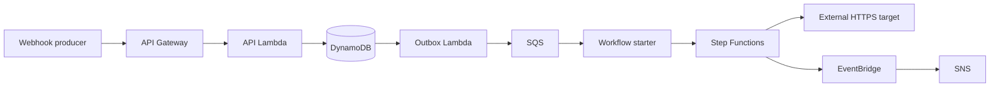

# RelayGuard

[](https://github.com/sssriesss/relayguard-monorepo/actions/workflows/ci.yml)
[](https://github.com/sssriesss/relayguard-monorepo/actions/workflows/security.yml)

RelayGuard is a serverless webhook delivery service and a multi-cloud
Infrastructure as Code reference project. It accepts signed webhook events,
persists them before acknowledging the request, processes them asynchronously,
retries transient failures, and keeps an auditable delivery history.

The repository combines three complementary components:

- `backend/`: a Python 3.12 application deployed with Serverless Framework to
  API Gateway, Lambda, and Step Functions;
- `frontend/`: a Next.js console for sending events, tracing jobs, replaying
  failures, and exploring the runtime architecture;
- `iac/`: reusable Terraform modules and isolated Terragrunt environments for
  AWS, GCP, Azure, and a complete local AWS environment powered by LocalStack.

## Architecture



Terraform owns durable infrastructure. Serverless Framework owns the
application runtime. The two stacks communicate through an SSM Parameter Store
contract, so neither needs to read the other's state.

## Repository layout

```text
.
├── backend/                         Python application and Serverless stack
├── frontend/                        Next.js operator console
├── iac/                             Terraform modules and Terragrunt units
└── README.md
```

## Requirements

Install these tools before running the full local environment:

| Tool | Supported version | Purpose |
| --- | --- | --- |
| Python | 3.12 or newer | Application and tests |
| Node.js | 20 LTS or newer | Serverless Framework |
| pnpm | 9.15 or newer | Frontend package manager |
| Terraform | 1.6 or newer, below 2.0 | Infrastructure modules |
| Terragrunt | 1.x | Environment orchestration |
| Docker | Current stable release | LocalStack runtime |
| LocalStack auth token | Valid token | Local AWS services and Lambda execution |

Git and a POSIX-compatible shell are also expected. Cloud deployments require
credentials for the selected provider.

## Run the complete stack locally

### 1. Install backend dependencies

```sh
cd backend
python3.12 -m venv .venv
.venv/bin/pip install --upgrade pip
.venv/bin/pip install -e '.[dev]'
npm ci
cd ..
```

### 2. Provision LocalStack and the foundation

Start Docker, obtain a LocalStack auth token, and expose it only in the current
shell:

```sh
export TF_VAR_auth_token='<your-localstack-token>'
cd iac/env/local/aws/applications/relayguard
terragrunt run --all --non-interactive -- apply -auto-approve
cd ../../../../../..
```

This command creates LocalStack and the DynamoDB, SQS, SNS, EventBridge, S3,
Secrets Manager, IAM, CloudWatch, and SSM resources required by RelayGuard.

### 3. Deploy the application

```sh
cd backend
npm run deploy:local
```

Serverless Framework prints the local API endpoint after deployment.

### 4. Verify the deployment

```sh
npm run test:e2e
```

The E2E suite exercises health checks, authentication, idempotency, transient
retries, permanent failures, replay, and persisted job history.

### 5. Run the operator console

In a second terminal, start the frontend:

```sh
cd frontend
cp .env.example .env.local
corepack enable
pnpm install --frozen-lockfile
pnpm dev
```

Open `http://localhost:3000` and paste the API endpoint printed by the backend
deployment. Add the local operator token to inspect and replay jobs, and the
local signing secret to send events. See the [frontend guide](frontend/README.md)
for connection security and cloud API configuration.

## Run checks without deploying

Backend checks do not require cloud access:

```sh
cd backend
npm run check
```

Frontend checks are also self-contained:

```sh
cd frontend
pnpm check
```

Infrastructure formatting and HCL validation do not require cloud credentials:

```sh
cd iac
terraform fmt -check -recursive terraform-modules
terragrunt hcl fmt --check
terragrunt hcl validate
```

Provider initialization requires internet access but does not create resources.
See the [infrastructure guide](iac/README.md) for module-specific validation.

## Continuous integration and security

Pull requests and pushes to `main` run independent backend, frontend, and IaC
quality gates. The workflows enforce formatting, linting, type checks, unit
tests, coverage thresholds, production builds, dependency integrity, Terraform
module validation, TFLint, and Terragrunt validation. Test and coverage reports
are retained as workflow artifacts.

The security workflow runs CodeQL for Python, JavaScript/TypeScript, and GitHub
Actions; Gitleaks secret detection; Trivy filesystem and IaC scanning; and
pull-request dependency review. Runtime dependency audits are blocking. Build
and development tooling remains visible to Dependabot and dependency review so
upgrades can be handled deliberately without hiding findings or making every
build permanently red.

All external actions are pinned to immutable commit SHAs. Dependabot checks the
action pins, both JavaScript workspaces, Python dependencies, and every
Terraform module each week. Neither workflow holds cloud credentials, applies
infrastructure, or deploys application code.

Accepted Trivy findings are narrowly scoped in `.trivyignore.yaml`, include a
rationale, and expire so infrastructure risks must be reviewed again rather
than disappearing into permanent suppressions.

## Deploy to cloud providers

The `dev` and `prod` environments currently provide deployable object-storage
examples for AWS, GCP, and Azure. Configure the identity placeholders and use
the standard credentials for the selected provider before planning or applying.

```sh
cd iac/env/dev/aws/s3/private
terragrunt run -- plan
terragrunt run -- apply
```

The complete RelayGuard foundation is currently implemented under the local AWS
environment. Deploying the backend to a real AWS account requires an equivalent
stage-specific foundation and SSM contract before running:

```sh
cd backend
npx serverless deploy --stage dev --region eu-west-1
```

The exact AWS contract and security requirements are documented in the
[backend guide](backend/README.md). Do not treat the example `dev` or `prod`
identities as production-ready configuration.

## Remove the local environment

Remove the application stack before its foundation:

```sh
cd backend
npm run remove:local
cd ../iac/env/local/aws/applications/relayguard
terragrunt run --all --non-interactive -- destroy -auto-approve
```

This deletes the LocalStack container and its Terraform-managed persistent data.

## Documentation

- [Backend development and deployment](backend/README.md)
- [Backend architecture](backend/ARCHITECTURE.md)
- [Frontend development and architecture](frontend/README.md)
- [Infrastructure setup and operations](iac/README.md)
- [Infrastructure conventions](iac/guidelines.md)

## Security notes

- Never commit credentials, provider tokens, secret values, state, plans, or
  generated deployment artifacts.
- Local secret values are fixtures and must never be reused outside LocalStack.
- Public storage examples are intentionally public and should be reviewed before
  use with real data.
- Replace the MVP operator token with identity-based authorization before
  exposing RelayGuard as a public service.
