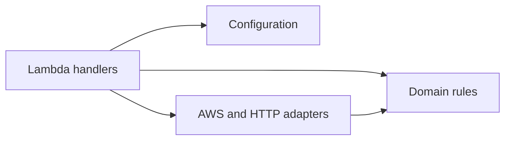

# Backend architecture

The RelayGuard backend follows a lightweight hexagonal architecture: business
rules stay independent from AWS, while handlers and infrastructure adapters
remain at the system boundary. The design favors plain functions and small
modules over framework-driven layering.

## Design principles

- Keep domain validation and state rules free from I/O.
- Keep Lambda handlers focused on translating requests and coordinating work.
- Pass infrastructure dependencies explicitly when a boundary needs isolation.
- Prefer the Python standard library unless a dependency provides clear value.
- Add abstractions only when they reduce meaningful coupling or duplication.
- Use structured logging and never log payloads, credentials, or signatures.
- Treat retries, duplicate events, and partial AWS batch failures as normal
  distributed-system behavior.

## Module boundaries

| Module | Responsibility |
| --- | --- |
| `domain.py` | Event validation, identifiers, signatures, statuses, and domain errors |
| `config.py` | Validated environment configuration |
| `http.py` | API Gateway request and response translation |
| `aws.py` | DynamoDB, Secrets Manager, and AWS client adapters |
| `api.py` | Public HTTP Lambda handler |
| `outbox.py` | DynamoDB stream to SQS publication |
| `workflow_starter.py` | SQS claim and Step Functions start |
| `normalize.py` | Workflow payload normalization |
| `deliver.py` | Authenticated outbound HTTPS delivery |
| `reconcile.py` | Recovery of stale or ambiguous jobs |

The current package is intentionally flat. Each module represents real behavior,
and the codebase does not need empty `ports`, `adapters`, `repositories`, or
`use_cases` trees to preserve its boundaries.

## Dependency direction

The domain does not import deployment configuration, AWS clients, or handler
modules. Infrastructure code may depend on domain types and invariants.

## Error handling

Domain errors represent conditions callers can handle deliberately, such as
authentication failure or an idempotency conflict. Infrastructure errors are
translated only at boundaries that can assign a safe response or retry policy.
Unexpected exceptions retain their original context and fail the invocation.

## Configuration

Runtime settings are read from environment variables populated by
`serverless.yml`. Infrastructure identifiers come from SSM Parameter Store;
secret values are fetched from Secrets Manager at runtime. Source files never
contain deployable credentials.

## Testing strategy

- Domain tests cover deterministic, side-effect-free behavior.
- Handler tests use lightweight stubs for AWS boundaries.
- Adapter tests assert DynamoDB transactions and partial batch responses.
- E2E tests exercise the deployed local application against LocalStack.

Tests focus on observable behavior and reliability invariants rather than
private implementation details.
